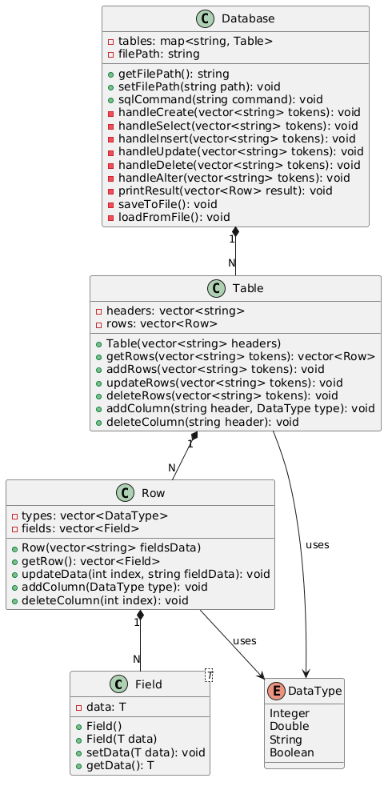

# SimQL

Projekt symulatora konsoli SQL (w stylu SQLite), który pozwala na prostę zarządzanie bazami danych.

## Schemat UML projektu

### [Wykaz AI](docs/AI.md)

#### *Stworzone przez: Grzegorz Wiśniewski*